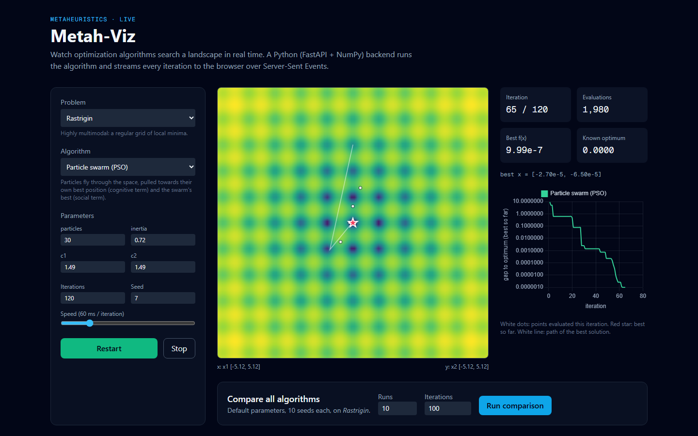
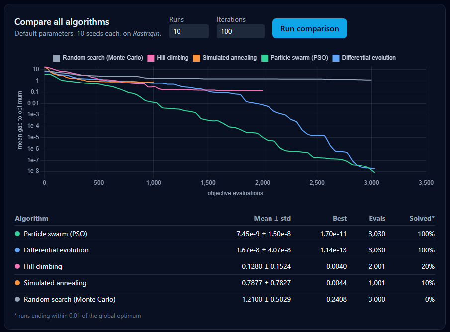

# Metah-Viz: metaheuristics, live


An interactive lab for optimization algorithms. Pick a problem and an algorithm, tune its
parameters, and watch it search the landscape in real time. A **Python (FastAPI +
NumPy)** backend runs the algorithm and streams every iteration to a **Next.js /
TypeScript** front end over **Server-Sent Events**.



## Features

* **5 algorithms**, all vectorised with NumPy and reproducible with a seed:
  random search (Monte Carlo), hill climbing, simulated annealing, particle swarm
  optimisation (PSO) and differential evolution (DE/rand/1/bin).
* **6 problems**: Rastrigin, Ackley, Himmelblau, Rosenbrock, Sphere, and a
  **constrained 4-D engineering problem** (pressure-vessel design cost, constraints
  handled by penalty). For more than 2 dimensions the map shows a 2-D slice through
  the best point; pick the axes.
* **Live view**: objective heatmap (log colour scale), the population at each
  iteration, the best-so-far point and its trajectory, and a log-scale convergence curve.
* **Compare mode**: runs every algorithm over N seeds and plots mean convergence
  against *objective evaluations*, the fair x-axis because algorithms spend very
  different numbers of evaluations per iteration. The table shows mean ± std, best and
  success rate.



On Rastrigin (100 iterations, 10 seeds), PSO and differential evolution reach the global
optimum in every run, while hill climbing (20 %) and simulated annealing (10 %) get trapped
in local minima. On the pressure-vessel problem, differential evolution finds the same
feasible design (cost 6,474.9) from every seed tried.

## Architecture

```
Next.js (React, TypeScript, Tailwind, Chart.js, <canvas>)
   │  GET /api/problems, /api/algorithms, /api/problems/{name}/grid
   │  GET /api/run?problem=&algorithm=&params=   ← text/event-stream, one event per iteration
   │  GET /api/compare?problem=&runs=
   ▼
FastAPI ── metaheuristics/
             ├── problems.py     vectorised objectives, bounds, constraints, grid slices
             └── algorithms.py   optimizers as generators: steps() yields the state per iteration
```

Every optimizer is a Python generator, so the same code powers the live stream, the
comparison endpoint and the tests. The stream stops when the browser disconnects.

## Run it

```bash
docker compose up --build        # → http://localhost:3000 (API on :8000, docs at /api/docs)
```

Or in development:

```bash
pip install -r requirements-dev.txt
uvicorn main:app --app-dir src/api --reload       # API on :8000
npm install && npm run dev                        # UI on :3000
```

**Deploying:** the API is a plain Docker image (`api.Dockerfile`, e.g. on Render or Fly.io;
set `CORS_ORIGINS` to the front-end URL). The front end deploys to Vercel with
`NEXT_PUBLIC_API_URL` pointing at the API.

## Tests

```bash
pytest                              # 27 tests: bounds, monotone best-so-far, seeding, convergence,
                                    # constraint feasibility, SSE stream, input validation
npm run typecheck && npm run lint
```
